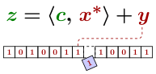

# LeakyMLDSA.jl

[](LICENSE)
[](https://heurekos.github.io/LeakyMLDSA.jl/ches-submission/stable)
[](https://heurekos.github.io/LeakyMLDSA.jl/ches-submission/dev)
[](https://github.com/JuliaTesting/Aqua.jl)

This repository contains the Julia implementation of the NLP attack described in [Section 6](https://heurekos.github.io/LeakyMLDSA.jl/tches2027_1-paper208.pdf#section.6) of the paper

> Kaveh Bashiri, Jan Geuenich, and Johannes Mittmann.
> [Exploiting noisy single-bit leakage in ML-DSA](https://heurekos.github.io/LeakyMLDSA.jl/tches2027_1-paper208.pdf).
> [*IACR Transactions on Cryptographic Hardware and Embedded Systems*](https://tches.iacr.org/index.php/TCHES/), 2027(1), xxx–xxx.

Examples demonstrating how to use the package can be found in the [documentation](https://heurekos.github.io/LeakyMLDSA.jl/ches-submission).

## Requirements

The package was developed primarily on an x86-64 laptop running Arch Linux.
It was also briefly tested on the same machine running Windows 11.
All functionality was successfully tested using the dependency versions pinned in the `{.,docs,test}/Manifest.toml` files.

Building the full documentation requires a Linux environment with standard build tools, as well as Rust and Python.
These dependencies are needed only to evaluate our attack on real ML-DSA signatures generated by OpenSSL and to compare its performance with that of a third-party solver written in Python and Rust.

The larger experiments, which are skipped when not enough memory is available, were run on an AMD EPYC system with 500 GB of RAM.

## Installation

First, ensure that Julia is [installed](https://julialang.org/install/) on your system.
The package was last tested with Julia 1.13.2.

### Option 1: Install Directly from GitHub

To install the package directly from GitHub, run the following in the Julia REPL:

```julia
julia> using Pkg
julia> Pkg.add(;
    url = "https://github.com/heurekos/LeakyMLDSA.jl.git",
    rev = "ches-submission",
)
```

### Option 2: Install from a Local Folder

To install the package from a local folder, navigate to the package directory and run in the Julia REPL:

```julia
julia> using Pkg
julia> Pkg.develop(; path = ".")
```

### Option 3: Run from a Local Folder

To use the package from a local folder without installing it to another environment, navigate to the package directory and run the following command to install its dependencies (required only once):

```
julia --project -e 'using Pkg; Pkg.instantiate()'
```

To start a Julia REPL with the local project environment activated, simply run:

```
julia --threads=auto --project
```

## Quick Start

The following example demonstrates how to use the package in a Julia environment where it is available:

```julia
using LeakyMLDSA

mldsa = MLDSA44(; p_err = 0.0, lambda = 6)
sigs = Signatures(mldsa; count = 5000, seed = 0)
result = run_attack(NLPAttack(sigs; timeout = 60))

key_guess(result) == sigs.key
```

For a more detailed guide, see the [documentation](https://heurekos.github.io/LeakyMLDSA.jl/ches-submission/stable/demo).

## Documentation

The package documentation is generated using [Documenter.jl](https://documenter.juliadocs.org/).
It produces many of the results discussed in the paper's remarks on the NLP attack.
Specific references are given on the individual documentation pages.

### Build on GitHub

It is automatically built and deployed using [GitHub Actions](https://docs.github.com/en/actions) whenever changes are pushed to the `ches-submission` branch.

Because the documentation includes computationally intensive examples and comparisons, the build takes approximately two hours to complete on GitHub.

### Build Locally

The documentation can also be built locally.
To do so, navigate to the package directory and install the documentation dependencies by running:

```
julia --project=docs -e 'using Pkg; Pkg.instantiate()'
```

Then build it by running:

```
julia --threads=auto --project=docs docs/make.jl
```

## Testing

The test suite can be run using:

```
julia --threads=auto --project -e 'using Pkg; Pkg.test()'
```
